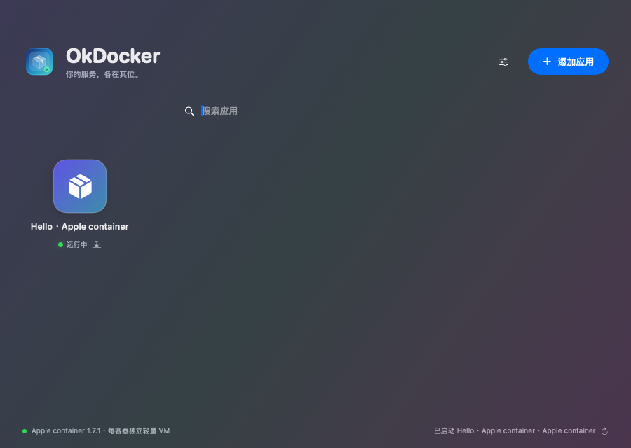

[中文](zh/README.md)

# OkDocker

A native macOS manager for container apps, built on Apple [container](https://github.com/apple/container).

Add an application folder to OkDocker and manage it from the launcher or menu bar: start it, open its page, check status and logs, or allow LAN access when you choose.



## Features

- **Native UI:** SwiftUI / AppKit, with a Liquid Glass launcher, icon grid, search, and menu bar.
- **Folder import:** `okdocker.json` declares the name, icon, image or Dockerfile, command, directory mounts, and frontend/backend ports. Multiple services are supported.
- **Versioned deploys:** Set `version`. A version change rebuilds from source and switches to a new container while keeping the stopped previous deployment. `build.script` runs the project's own Linux build script.
- **App management:** Click an icon to start or open the page. Right-click for logs, settings, force stop, or removal. Status comes from the real containers plus an HTTP probe.
- **LAN access:** A per-app switch. View, open, and copy the Mac's LAN address without rebuilding a running container.
- **Login startup:** Optional for the manager and for each app. Off by default.
- **Android access:** An app may use shared ADB to reach Android devices already authorized on the Mac. Other Mac ADB tools keep working.
- **Rules for an AI assistant:** Read the configuration document in the app and copy it. It does not include imported app data or credentials.

The launcher language defaults to English. Use the language menu in the window to switch between English and 中文.

## How it runs

```text
SwiftUI / AppKit
        │
Registry, configuration checks, and lifecycle
        │
Apple container CLI
        │
Containerization / Virtualization.framework
        │
One lightweight Linux VM per container
```

OkDocker is written in Swift and uses Apple's official CLI for OCI pulls, Dockerfile builds, and container management. Running an app does not require Docker Engine, Compose, or Colima. This build targets **container 1.7.1** and Linux arm64 images.

- **Directories and config:** Import checks relative paths, mount scope, and ports, and stores a configuration digest. Startup checks again. Host mounts stay inside the application directory. The home directory is not shared by default.
- **Runtime and data:** Each app has its own network and ownership labels. Management actions affect only that app's containers. Stopping and starting the same version reuses the container. A version change builds a new image and switches deployment; the old container is stopped and kept. A new container does not inherit the old writable layer. Persist data with an explicit mount.
- **LAN gateway:** Container ports stay published on `127.0.0.1`. When LAN access is on, a separate native TCP helper forwards the approved frontend and backend ports to the Mac's current private Wi-Fi / Ethernet IPv4 address. The container configuration does not change.
- **Android channel:** A private Unix socket and a token-checked Mac helper reach the Mac ADB server. New Apple containers run the relay inside the approved backend container, so the phone bridge does not get its own VM. ADB is not published to the LAN, and USB ownership is not transferred.
- **Background:** The UI is separate from containers and helpers. Closing the window or quitting OkDocker does not stop running services. Login startup uses `SMAppService`.

## Install

### Requirements

- Apple Silicon Mac
- macOS 26 or later
- Apple [container 1.7.1](https://github.com/apple/container/releases/tag/1.7.1)
- Building from source needs Xcode 26 or later, plus Python 3. The Android relay binary is already in `Resources/Android`; rebuilding it needs Go.
- Android access needs a working `adb` on the Mac, and a device with USB debugging authorized.

### Build from source

Install Apple's signed container package, then from this repository:

```sh
bash scripts/build-app.sh
open dist/OkDocker.app
```

To install into an Applications folder:

```sh
python3 scripts/install-app.py
```

The installer backs up the previous app bundle and replaces it. It prefers `/Applications`, then `~/Applications`. The default build is ad-hoc signed, not a Developer ID notarized release.

## Use

### Add and start an app

1. Open OkDocker and click **Start runtime**. The first run downloads a Linux kernel.
2. Put [`okdocker.json`](CONFIGURATION.md) in the application root. [`examples/hello`](examples/hello) can be imported as a complete example.
3. Click **Add app**, choose the folder or the config file, and confirm the directory, ports, and permissions. Import only registers the app.
4. Click the icon to start. The first start may pull or build. Click again to open the page.
5. Right-click for the backend URL, logs, settings, or force stop.

To prepare a project, open **Configuration rules** and click **Copy the full rules for AI**, then describe the project. Field rules are in [CONFIGURATION.md](CONFIGURATION.md).

### Update an app

After changing source, increase `version` in `okdocker.json`, for example `1.0.0` to `1.0.1`, then start or right-click **Start / check for update**. A version change builds a new image while reusing dependency cache. The old service stops only after that build succeeds. The same version is not rebuilt. Opening the page does not update.

A project may set `script` under `services.<name>.build`:

```json
"build": {"context": ".", "dockerfile": "Dockerfile", "script": "scripts/build.sh"}
```

The script is relative to the build context and runs in a Linux build stage, not on the Mac. The Dockerfile must copy sources, prepare the toolchain, and include a single `# okdocker:build-script` line after `COPY` / `WORKDIR`. The final image is still defined by the Dockerfile. See [`examples/scripted-web`](examples/scripted-web) and the [configuration guide](CONFIGURATION.md#custom-build-script).

An update pauses the service briefly. Mounted data stays in the host directory. Unmounted container data is not copied into the new container. Back up and handle data migrations yourself. Old deployments remain and use disk. An `image` service is pulled again and gets a new container; it is not compiled from source.

### LAN access

Turn on **Allow LAN access** from the context menu or app settings, then copy the ready address to another device.

LAN access is off by default. It supports private IPv4 on Wi-Fi / Ethernet only, not IPv6, VPN, or a public bind. Clients must be able to reach the Mac. The app provides its own authentication.

### Stopping and data

- **Close the window:** the menu bar and running services stay.
- **Quit OkDocker:** containers and an already enabled LAN gateway stay.
- **Force stop:** sends `SIGKILL` to that app's containers. Files and writable layers are kept, but in-flight work and writes can be damaged.
- **Remove app:** deletes the registration and that app's stopped containers from every generation. The host application directory stays. Unmounted container data is deleted with the containers.

Changing only `version` can deploy immediately. Any other configuration or approved-directory change must be imported again, as described in [CONFIGURATION.md](CONFIGURATION.md). A missing approval baseline also needs a fresh import. Writable layers are not deleted silently because the manager was upgraded.

Import only apps you trust. Directory limits and the Android switch are not a complete network or device sandbox. LAN access does not add authentication for you.

## Command line

The GUI and CLI share one registry:

```sh
APP=/Applications/OkDocker.app/Contents/MacOS/OkDocker

"$APP" --cli import /path/to/app
"$APP" --cli list
"$APP" --cli start <ID>
"$APP" --cli status <ID>
"$APP" --cli deployments <ID>
"$APP" --cli lan <ID> on
"$APP" --cli lan <ID> off
"$APP" --cli close <ID> --force
```

The registry is in `~/Library/Application Support/OkDocker/`. Run `swift test` for the unit tests.

## More documents

- [Configuration](CONFIGURATION.md)
- [Architecture](docs/ARCHITECTURE.md)
- [Apple container backend](docs/APPLE-BACKEND.md)
- [Third-party components and licenses](THIRD_PARTY.md)

## License

OkDocker is under the [MIT License](LICENSE). Apple container and other third-party components keep their own licenses.

While starting or building, the icon shows **Starting** across GUI and CLI launches. **View logs** opens live startup/build output even before a container exists. Dependency layers remain cached; a version change reruns the declared `build.script` while reusing earlier layers. Without a script, normal Dockerfile content-based cache invalidation applies.
